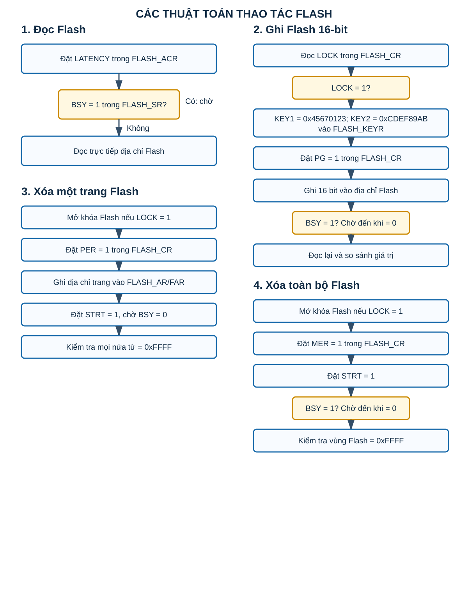
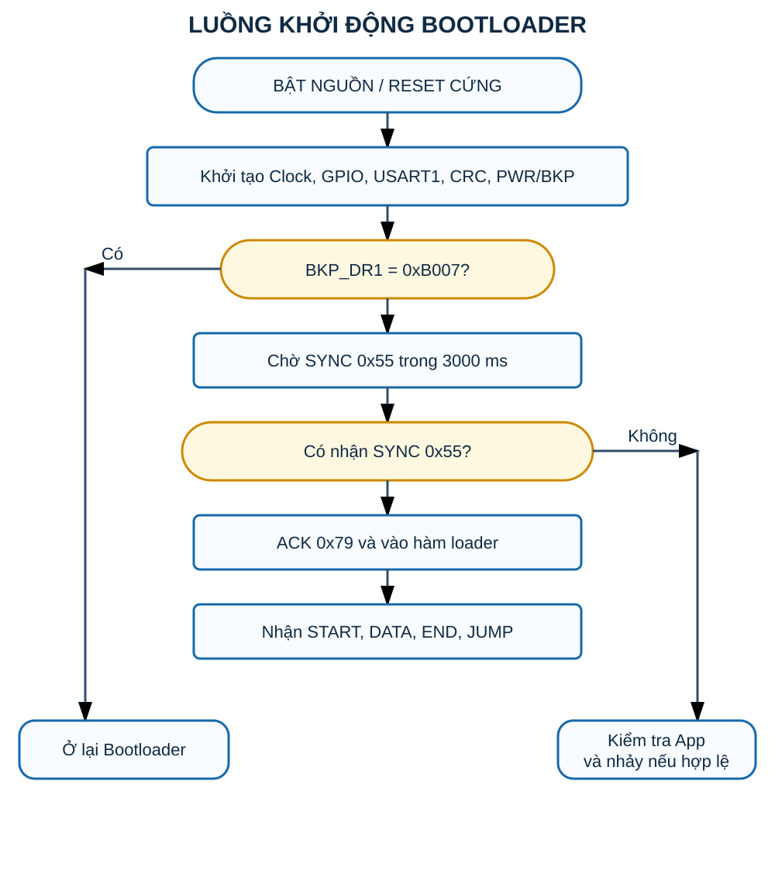
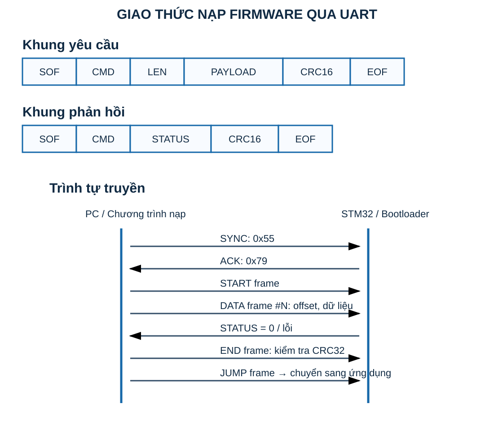
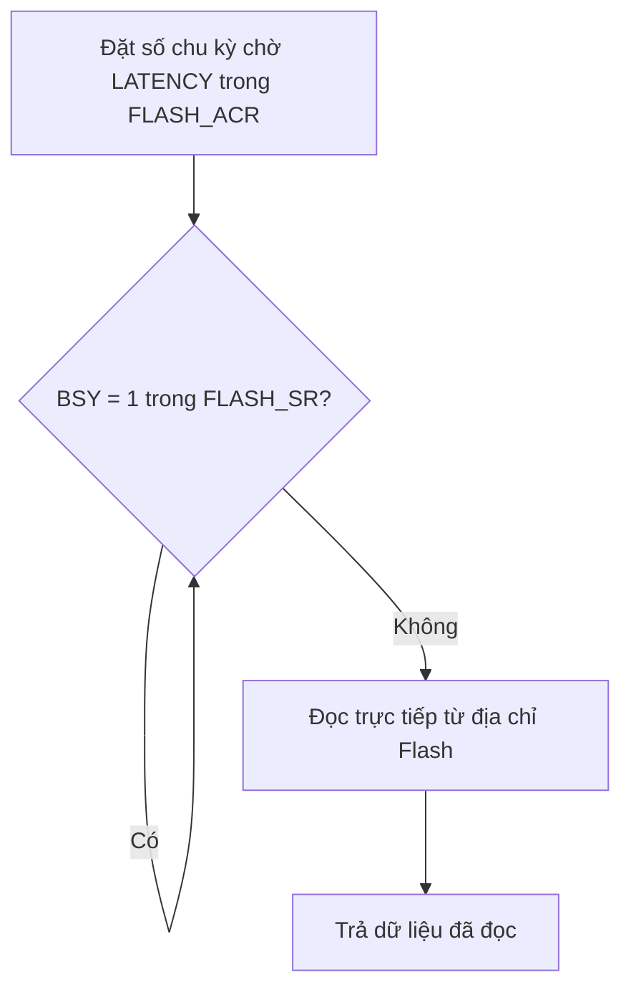
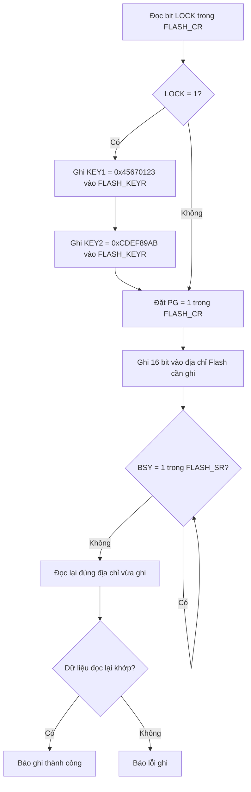
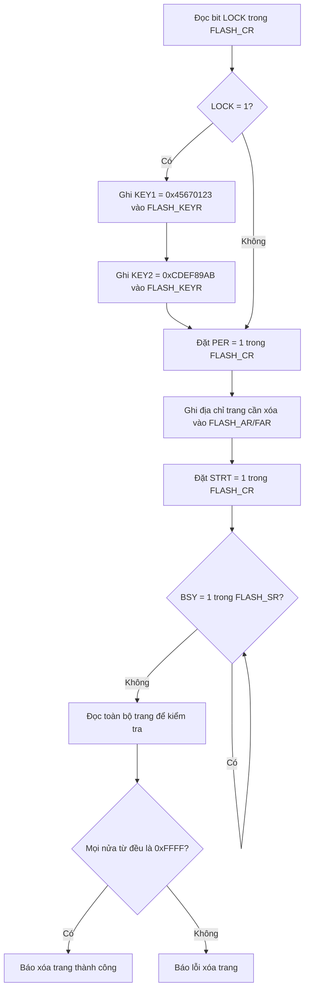
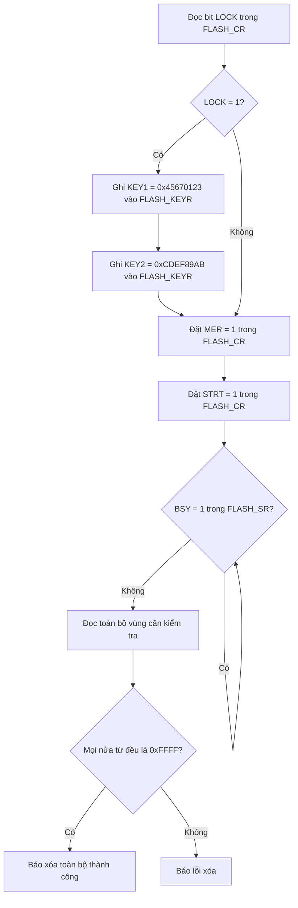
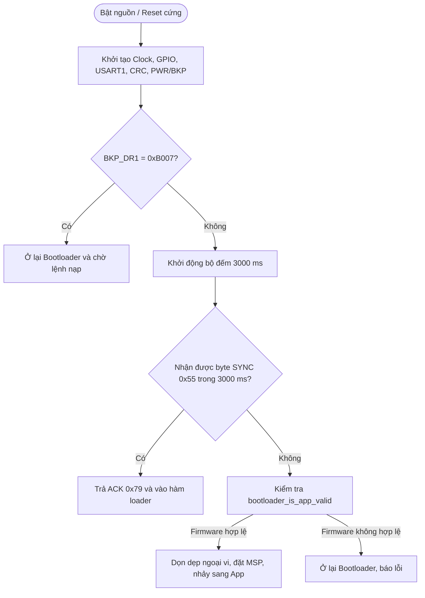
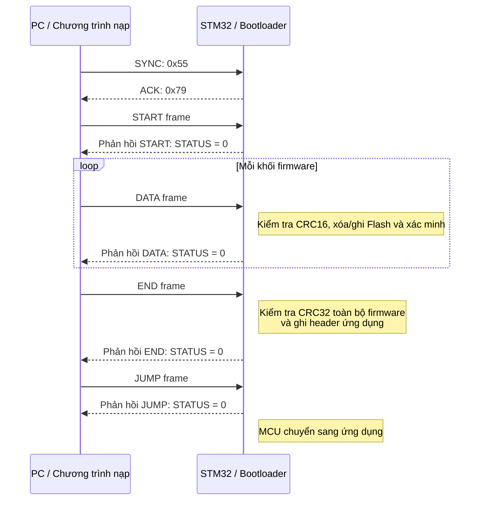

# Bootloader STM32 – Cập nhật firmware qua UART

## Mục tiêu

Bootloader cho STM32 nhận firmware từ máy tính qua UART, kiểm tra dữ liệu, xóa và ghi vùng Flash ứng dụng, sau đó chuyển sang chạy firmware mới. Dự án cũng có các hàm đọc, ghi, xóa Flash ở mức thanh ghi.

## Sơ đồ trực quan

### Thao tác Flash: đọc, ghi, xóa trang và xóa toàn bộ



### Luồng khởi động Bootloader



### Khung UART và trình tự nạp firmware



Các phần bên dưới là lưu đồ Mermaid và phần giải thích chi tiết tương ứng với các sơ đồ ảnh phía trên.

## 1. Thuật toán đọc Flash



Việc đọc Flash không cần mở khóa Flash. Trước khi đọc, chương trình chờ bit `BSY` về `0` để bảo đảm không có thao tác ghi hoặc xóa đang diễn ra. Dữ liệu được đọc trực tiếp từ địa chỉ vùng Flash.

## 2. Thuật toán ghi Flash 16-bit



Khi Flash đang bị khóa, hai khóa `KEY1` và `KEY2` được ghi liên tiếp vào `FLASH_KEYR` để mở khóa. Bit `PG` cho phép chế độ lập trình. Mỗi lần ghi là một nửa từ 16-bit; chương trình chờ `BSY = 0` rồi đọc lại để xác minh giá trị.

## 3. Thuật toán xóa một trang Flash



Bit `PER` chọn xóa theo trang. Địa chỉ của trang cần xóa được nạp vào thanh ghi địa chỉ Flash, sau đó đặt `STRT` để bắt đầu. Khi `BSY` trở về `0`, chương trình kiểm tra toàn bộ trang: Flash đã xóa phải có giá trị `0xFFFF` tại từng đơn vị 16-bit.

## 4. Thuật toán xóa toàn bộ Flash



Bit `MER` chọn chế độ xóa hàng loạt. Sau khi xóa hoàn tất, nội dung vùng Flash được kiểm tra để bảo đảm không còn dữ liệu cũ trước khi nhận firmware mới.

## 5. Luồng khởi động của Bootloader



Sau reset, bootloader có thể được giữ lại bằng cờ `BKP_DR1 = 0xB007`. Nếu không có cờ này, bootloader chờ byte đồng bộ `SYNC = 0x55` trong 3 giây. Nếu không có yêu cầu nạp và firmware ứng dụng hợp lệ, MCU sẽ nhảy sang ứng dụng; ngược lại vẫn ở bootloader.

## 6. Định dạng khung UART

### Khung yêu cầu từ máy tính

```text
┌─────┬─────┬─────┬─────────┬───────┬─────┐
│ SOF │ CMD │ LEN │ PAYLOAD │ CRC16 │ EOF │
└─────┴─────┴─────┴─────────┴───────┴─────┘
```

### Khung phản hồi từ bootloader

```text
┌─────┬─────┬────────┬───────┬─────┐
│ SOF │ CMD │ STATUS │ CRC16 │ EOF │
└─────┴─────┴────────┴───────┴─────┘
```

- `SOF` / `EOF`: đánh dấu đầu và cuối khung.
- `CMD`: mã lệnh, ví dụ `START`, `DATA`, `END`, `JUMP`.
- `LEN`: độ dài trường dữ liệu.
- `PAYLOAD`: dữ liệu lệnh hoặc một khối firmware.
- `CRC16`: kiểm tra lỗi của khung truyền.
- `STATUS`: trạng thái xử lý, `0` là thành công; giá trị khác `0` là lỗi.

## 7. Trình tự nạp firmware qua UART



Quá trình bắt đầu bằng `SYNC 0x55`; bootloader đáp lại `ACK 0x79`. Máy tính gửi `START`, rồi truyền các khung `DATA` chứa firmware. Với từng khung, bootloader kiểm tra CRC16, xử lý Flash và trả `STATUS`. Khi nhận `END`, bootloader kiểm tra CRC32 toàn bộ firmware, ghi header ứng dụng và chỉ cho phép `JUMP` khi firmware hợp lệ.
